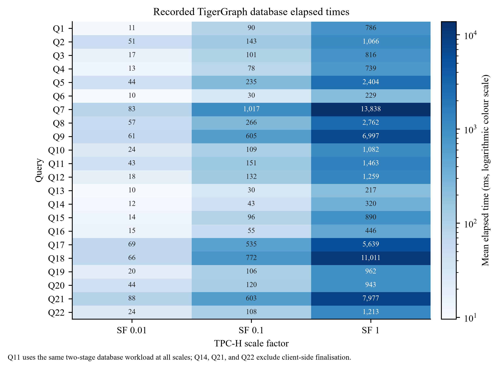
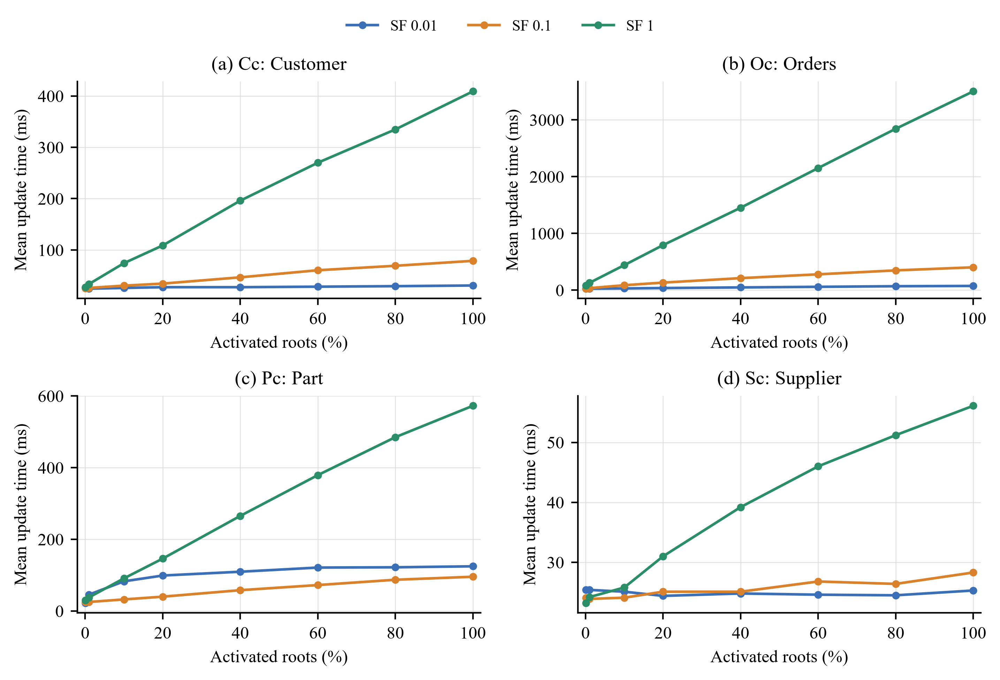

# TPC-H E/R Graph Workloads for TigerGraph

This repository contains my TigerGraph implementation of the graph-semantics workloads described by Philipp Skavantzos and Sebastian Link. I used TigerGraph 4.2.4 and openCypher for measured query and update operations. GSQL is used to create and load the graph, and for setup or cleanup steps that are not timed.

This repository is not presented as an independently maintained open-source package. The implementation is an
adaptation of the Neo4j reference workload rather than a line-for-line port or a controlled
database-product benchmark.

It covers TPC-H Q1--Q22 at scale factors 0.01, 0.1, and 1; Entity Integrity checks; the Cc, Oc, Pc, and Sc Referential Integrity workloads; and an adapted RF1/RF2 graph-maintenance workload. TPC-H data, Docker data, dissertation files, credentials, and diagnostic logs are not included.

## Environment

- TigerGraph Community Edition 4.2.4
- Python 3.11.9
- Docker Desktop on Windows 11

```powershell
python -m pip install -r requirements.txt
```

## Directory layout

```text
setup/                              Schema and data-loading scripts
queries_and_refresh_operations/     Q1--Q22 runners and RF1/RF2
entity_integrity/                   Entity Integrity checks
referential_integrity/              Referential Integrity workloads
results/q*/                         Parameter schedules for the 20 runs
examples/                            Small result summary
results_summary/                     Module-level formal summaries and provenance
evidence/                            Curated raw, summary, manifest, and correctness records
figures/                             Selected result and schema figures (PNG and PDF)
docs/                                Experiment and migration notes
```

For a short inspection route, see [`docs/reviewer_guide.md`](docs/reviewer_guide.md).
The full command order is in [`docs/experiment_commands.md`](docs/experiment_commands.md),
and [`docs/reference_mapping.md`](docs/reference_mapping.md) maps the Neo4j reference
components to their TigerGraph counterparts.

## Preparing the graph

Generate TPC-H data for SF 0.01, 0.1, or 1, then convert it to the vertex and edge CSV files expected by the loading jobs. The sample scripts use `/home/tigergraph/tpch_data/graph/` inside the container; change this path if the data are stored elsewhere. The schema is `setup/schema_graph.gsql`.

The loading-job structure is data-scale independent. `load_graph_sf01.gsql` was named for
the SF 0.1 experiment in which it was introduced, but it can load SF 0.01 staging CSVs when
the supplied paths point to that dataset. `load_graph_sf1.gsql` is retained separately because
it records the final SF 1 loading procedure used in the project. Do not load a new scale on
top of an existing graph without first using a clean database/container.

## Running Q1--Q22

Install the required queries in `TPCH_G` first. Each test uses 20 runs. I sort the 20 database times, remove the fastest five and slowest five, and report the mean of the middle ten.

The query-definition files contain `CREATE OR REPLACE OPENCYPHER QUERY` statements.
Installation order and the special multi-stage query files are listed in
[`docs/query_installation.md`](docs/query_installation.md). The runners execute installed
query names; they do not install or replace database queries automatically.

Check the runner configuration without connecting to TigerGraph:

```powershell
python queries_and_refresh_operations/scripts/run_benchmark.py --queries 1,3,4,5,6,7,9,10,11,12,13,14,15,16,17,18 --scale 0.01 --dry-run
python queries_and_refresh_operations/scripts/run_benchmark.py --queries 2,8,19,20 --variant neo4j-compatible --scale 0.01 --dry-run
```

For comparison with the Neo4j reference workload, I use the compatible files for Q2, Q8, Q19, and Q20. Q11 runs in two stages because its threshold cannot be passed through one TigerGraph openCypher statement in the same way. The main runner selects this version automatically.

Q21 and Q22 use a separate runner because Python is needed to produce their complete final CSV files:

```powershell
python queries_and_refresh_operations/scripts/run_q21_q22_final.py --query both --q21-variant neo4j-compatible --q22-variant neo4j-compatible --scale 0.01
```

The main runner does not accept Q21 or Q22, which prevents an intermediate database result from being used as the final result. Q11 and Q22 each use two database calls; their database time is the sum of those calls.

## Other experiments

See `entity_integrity/README.md`, `referential_integrity/README.md`, and `queries_and_refresh_operations/rf1_rf2/README.md`. Check the host, graph, scale factor, and entity counts before running them.

## Timing and interpretation

TigerGraph database time comes from `query_status.elapsedTime`. I do not report a TigerGraph equivalent of Neo4j DB Hits because the systems do not provide the same metric. Cross-system results compare implementation and scaling trends; they are not a controlled product ranking.

The global Entity Integrity queries count duplicate conceptual E/R keys. Zero means these checks found no duplicate, not that TigerGraph enforces the keys automatically.

The RF scripts create and delete the vertices and relationships needed for this experiment. They do not include every attribute from the official TPC-H refresh tuples, so I treat them as graph-maintenance workloads rather than complete TPC-H refresh functions.

## Included results

`examples/project_final_master_summary.csv` is a snapshot of the dissertation's retained
formal summary. Times are milliseconds and, unless a row says otherwise, are the mean of the
middle ten values after sorting 20 runs and trimming five values from each side.

`evidence/` contains the compact formal evidence set: per-run raw timings and summaries for
Q1--Q22 at all three scales, Entity and Referential Integrity records, completed RF1/RF2
runs, and the retained correctness checks. `evidence/evidence_manifest.csv` records the size
and SHA-256 digest of every included file, while `evidence/query_source_map.csv` identifies
the full-project source selected for each query result. Failed attempts, retry logs, repeated
output dumps, and exploratory results are omitted.

Module-level tables and evidence qualifications are available under `results_summary/`.
The same directory includes the cross-scale query and integrity-growth comparison tables used
to generate the dissertation's Neo4j--TigerGraph scaling figures.
Selected figures are available as both PNG previews and PDF originals under `figures/`.

## Results overview





The figures report the retained formal series and should be read with the timing and
comparability qualifications in `docs/experiment_protocol.md` and
`results_summary/result_provenance.md`.

## Reference work

This project adapts the graph-semantics workload introduced in:

Philipp Skavantzos and Sebastian Link. 2025. *Entity/Relationship Graphs:
Principled Design, Modeling, and Data Integrity Management of Graph Databases*.
Proceedings of the ACM on Management of Data 3(1), Article 40, 1--26.
https://doi.org/10.1145/3709690

## Review status

This repository copy is supplied for academic review. No open-source licence is granted.
